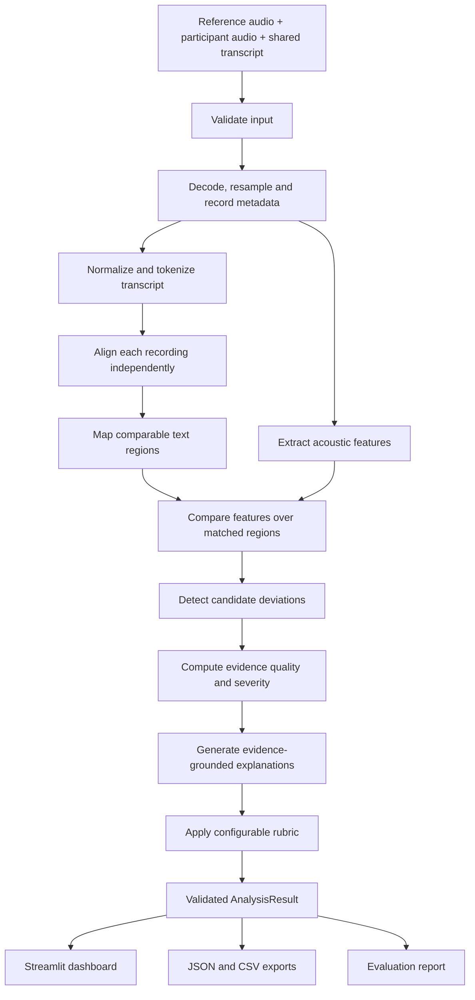

# VocalLens — System Architecture

**Project:** VocalLens  
**Track:** Contrastive Speech Analytics & Temporal Flaw Grounding  
**Specification status:** Implementation-ready starting contract; thresholds remain provisional until evaluated.  
**Primary language:** English (`en-US`) for the MVP.  
**Primary principle:** Every reported deviation must be traceable to a measured feature, time region, comparison baseline, configured rule, and explicit quality assessment.

---

## 1. Product Goal

VocalLens compares two recordings of the same English text:

- **Reference recording:** the intended or rubric-compliant delivery.
- **Participant recording:** the delivery being analyzed.

It identifies candidate delivery differences, localizes them in time, and explains them with evidence such as pause duration, speech rate, pitch variation, or relative energy dynamics. Users can inspect evidence in an interactive dashboard and export the analysis.

VocalLens is a comparison and coaching prototype, not an objective judge of a speaker's ability, personality, confidence, intelligence, or emotional state. A difference from the reference is not automatically a mistake: intentional emphasis, accent, speaking style, and context matter.

### Success criteria

1. Users can provide two recordings and their shared transcript.
2. The system aligns supplied words to each recording when supported by the selected aligner.
3. It compares comparable text regions rather than assuming matching absolute timestamps.
4. Each detection includes interval, feature evidence, baseline comparison, rule, severity, and quality flags.
5. Missing or unreliable measurements are unavailable, not silently replaced with zero.
6. Dashboard, evaluation scripts, and exports use the same analysis engine.
7. Repository setup and results are reproducible and honest about limitations.

---

## 2. Scope and Non-Goals

### In scope
- Audio upload and shared transcript input.
- Reference-versus-participant analysis.
- Forced alignment and text-region mapping.
- Timing, pause, pitch, energy, and spectral feature extraction.
- Candidate deviations for pace, pause management, pitch variation, and energy dynamics.
- Temporal evidence and human-readable explanations.
- Dimension scores from a configurable provisional rubric.
- Streamlit dashboard, plots, playback, JSON/CSV exports.
- Dataset manifest, annotations, evaluation scripts, reproducibility instructions.

### Out of scope for the MVP
- Claiming acoustic measurements prove intent or cause audience outcomes.
- Inferring personality, honesty, intelligence, mental health, or emotion as fact.
- Treating one accent, voice, or speaking style as universally correct.
- Training a custom speech model from scratch.
- Using MFCCs alone as proof of a rhetorical flaw.
- Promising real-time performance before measuring it.
- Fabricating alignment timestamps when alignment fails.

---

## 3. System Overview



**Single source of truth:** the pipeline returns `AnalysisResult`. The UI must not reimplement alignment, detection, explanation, or scoring.

---

## 4. Repository Layout

```text
vocallens/
├── README.md
├── CLAUDE.md
├── ARCHITECTURE.md
├── DESIGN.md
├── pyproject.toml
├── requirements.txt
├── .gitignore
├── configs/
│   ├── scoring.yaml
│   └── analysis.yaml
├── data/
│   ├── README.md
│   ├── manifest.csv
│   ├── annotations/
│   └── samples/                 # licensed/public or consented audio only
├── src/vocallens/
│   ├── __init__.py
│   ├── schemas.py
│   ├── audio_io.py
│   ├── transcript.py
│   ├── alignment.py
│   ├── region_mapping.py
│   ├── features.py
│   ├── detection.py
│   ├── quality.py
│   ├── explanations.py
│   ├── scoring.py
│   ├── pipeline.py
│   └── export.py
├── app/
│   └── streamlit_app.py
├── scripts/
│   ├── build_dataset_manifest.py
│   ├── run_evaluation.py
│   └── validate_dataset.py
├── tests/
│   ├── test_transcript.py
│   ├── test_region_mapping.py
│   ├── test_features.py
│   ├── test_quality.py
│   ├── test_scoring.py
│   ├── test_pipeline.py
│   └── fixtures/
├── reports/evaluation/           # generated outputs; never prefilled with fake metrics
└── docs/
    ├── technical_report.md
    └── demo_script.md
```

Keep module responsibilities explicit. If implementation evidence requires changing this layout, update this document and the implementation together.

---

## 5. Technology and Language Decisions

| Concern | Initial choice | Constraint |
|---|---|---|
| Language | Python 3.11 | Verify actual environment |
| Dataset language | English, `en-US` | Do not claim multilingual support in MVP |
| Audio/features | NumPy, SciPy, librosa | Test silence, noise, short clips, invalid values |
| Alignment | WhisperX first | Must pass the three-clip feasibility gate |
| Alignment fallback | Montreal Forced Aligner (MFA) | Only with compatible acoustic model and dictionary |
| English syllable estimate | `pronouncing` / CMU Pronouncing Dictionary | Word rate remains primary; report OOV coverage |
| Dashboard | Streamlit | Prefer robust native interactions |
| Charts | Plotly | Label units and recording-specific timestamps |
| Data contracts | Typed dataclasses or Pydantic | Validate request/result boundaries |
| Configuration | YAML | Validate ranges, units, and defaults |
| Tests | pytest | Unit, integration, and failure-path tests |
| CI | GitHub Actions | No private audio or secrets in CI |
| Exports | Versioned JSON + detections CSV | Stable schema and explicit unavailable values |

Pin versions after installing and testing a clean environment. Never invent dependency pins or compatibility claims.

### Alignment feasibility gate

1. Select three short, licensed or consented English clips.
2. Run the selected WhisperX alignment path with their transcripts.
3. Inspect word timestamps for drift, missing words, and unsupported model behavior.
4. Record package/model version, language, hardware, and outcomes.
5. If it fails, try MFA only when a compatible model and dictionary are installed.
6. Stop aligner troubleshooting after **30 minutes of focused feasibility work**. If neither route works within that budget, record the blocker and return explicit `unavailable`/`partial` status; continue independently testable work without fabricating timestamps.

Forced alignment maps supplied text to audio; it does not verify transcript correctness.

---

## 6. Audio Ingestion and Preprocessing

- Preserve original upload metadata.
- Decode to floating-point mono for analysis.
- Resample the analysis copy to **16,000 Hz**; retain original files unchanged for playback/export where appropriate.
- Convert stereo to mono by documented channel averaging. If channels differ materially, emit a warning.
- Do **not** peak-normalize or loudness-normalize the waveform before energy analysis.
- Record original sample rate, channel count, duration, peak, clipping indicator, and analysis sample rate.
- Reject corrupt audio with actionable messages and enforce configured size/duration limits.
- Apply the same preprocessing policy to reference and participant recordings.

The 16 kHz rate is the MVP default, not a claim that every aligner model requires it. If a tested model requires a different rate, record and test the adaptation.

---

## 7. Core Data Contracts

Use seconds for timestamps. Every feature value includes a unit and validity/quality information.

### `AnalysisRequest`
- `reference_audio`: validated path or in-memory audio object.
- `participant_audio`: validated path or in-memory audio object.
- `transcript`: required shared transcript.
- `language`: defaults to `en-US`.
- `sample_id`: stable identifier.
- `analysis_config`: validated config or config path.
- `metadata`: optional, non-sensitive provenance.

### `AnalysisResult`
- `schema_version`, `sample_id`
- `status`: `complete`, `partial`, or `failed`
- warnings with codes and human-readable messages
- audio metadata for each recording
- normalized transcript tokens and original text
- independent reference/participant alignments with model, status, and coverage
- region mapping with matched/missing/inserted/unmapped tokens
- feature series with timestamps, units, validity masks, and settings
- detections with interval, family, measured values, delta, rule, severity, quality, and explanation
- per-dimension scores, validity, and coverage
- overall prototype score or `null`
- provenance: software/model/config versions and config hash
- per-stage timings

### Detection record
- stable detection ID and family
- participant start/end time
- matched reference region and reference interval when available
- feature name, participant value, reference value, delta, and unit
- triggering rule and threshold
- normalized threshold exceedance
- severity level and evidence-quality score/label
- evidence-based explanation and caveat
- review status (`automatic`, `human_reviewed`, etc.)

Every displayed detection must be traceable to values and a rule.

---

## 8. Analysis Pipeline

Public entry point:

```python
def analyze_pair(request: AnalysisRequest) -> AnalysisResult:
    """Analyze participant delivery against a reference for shared text."""
```

### 8.1 Validate and decode
Check files, transcript, size, duration, decodability, and finite samples. Return actionable errors. Do not log raw audio or full transcripts unnecessarily.

### 8.2 Normalize transcript
- Normalize Unicode and whitespace.
- Tokenize consistently while retaining original text/character spans.
- Use conservative case and punctuation normalization for matching.
- Preserve meaningful numbers, contractions, and word boundaries.
- Keep the original transcript for display.

### 8.3 Align each recording independently
- Align the supplied transcript separately to reference and participant audio.
- Store aligner/model/language/status.
- Validate timestamps: finite, `start <= end`, within duration, and plausible token order.
- Preserve partial alignment with partial status.
- Never fabricate timestamps for missing words.

### 8.4 Map comparable text regions
1. Normalize alignment token sequences with the same rules.
2. If sequences match, map by token index.
3. Otherwise use Levenshtein sequence alignment to label matched, missing, and inserted tokens.
4. Define mismatch ratio as edit distance divided by the larger normalized token count.
5. If mismatch ratio is **greater than 0.20**, mark text mapping partial and do not compare regions that cannot be mapped confidently.
6. A phrase is eligible only when at least **80% of expected tokens are matched and aligned**.
7. Build phrase windows from matched tokens with configurable context.
8. Compare each recording's features over its own mapped time interval.

The thresholds are provisional safeguards. Store the ratios in the result. Never compare identical absolute timestamps by default.

### 8.5 Extract features

Use short overlapping frames; defaults live in `configs/analysis.yaml`.

| Family | Measurements | Interpretation limit |
|---|---|---|
| Timing | Phrase duration, word rate; estimated syllable rate when supported | Alignment and transcript quality constrain reliability |
| Pauses | Silence intervals/duration and phrase-boundary location | Noise-floor and VAD thresholds affect boundaries |
| Pitch | F0 median and **IQR of F0 in semitones**, voiced coverage | F0 can fail on unvoiced/noisy segments |
| Energy | RMS in dBFS and within-recording relative energy dynamics | Absolute level is confounded by gain, distance, and room |
| Spectral | MFCC summaries and selected descriptors | Diagnostic/visualization only, not standalone proof |

#### Pause detection
1. Compute frame RMS in dBFS.
2. Estimate the noise floor from low-energy frames using the configured percentile.
3. Mark silence candidates using the configured absolute ceiling and noise-floor-relative margin.
4. Merge candidate intervals separated by gaps no longer than `merge_gap_ms`.
5. Keep intervals at least `min_pause_duration_ms`.
6. Flag unreliable noise-floor estimation, heavy background noise, and clipping.
7. Validate boundaries against manually reviewed clips.

The implementation must define exactly how the absolute and relative thresholds combine, load them from config, and test boundary cases. Poor-quality silence estimates are not ground truth.

#### Rate estimation
Word rate is primary: eligible aligned word count divided by phrase duration. For English syllable rate, use `pronouncing` with the CMU Pronouncing Dictionary. Exclude OOV words from the syllable count and report coverage; if coverage is below the configured minimum, mark syllable rate unavailable.

#### Pitch variability
Use F0 in Hz internally. Convert voiced F0 samples to semitones with `12 * log2(F0_Hz / 1 Hz)` and compute IQR (75th percentile minus 25th percentile) in semitones. The 1 Hz reference only adds a constant to the transformed values, so it **does not affect the IQR**; the ratio form makes the dimensionless logarithm explicit. Also report median F0 in Hz. Do not mix Hz-range and semitone-IQR in one comparison. If voiced-frame coverage is below the configured minimum, mark the metric unavailable.

#### Energy normalization
Do not loudness-normalize waveforms before measuring energy.

- Compute frame RMS and express it as dBFS with a configured numerical floor.
- For each recording, compute the median and IQR of RMS dBFS over valid speech frames.
- Compute a phrase's median RMS dBFS, then standardized relative energy `z_rel = (phrase_median_dbfs - recording_speech_median_dbfs) / max(recording_speech_IQR_db, energy_iqr_floor_db)`.
- Compare `z_rel` values only when both recordings have sufficient valid speech frames.
- Show absolute dBFS as diagnostic metadata only; do not use it as a direct cross-recording speaker-loudness judgment.
- If clipping, gain, microphone distance, or recording conditions may confound the comparison, attach a warning. Relative energy is still a candidate signal, not proof of emphasis or projection.

### 8.6 Detect candidate deviations
Each rule defines required inputs, validity checks, formula, units, threshold, coverage, interval, and explanation.

Initial families:
1. **Pace:** word-rate difference or phrase-duration difference.
2. **Pause:** pause duration differs from the matched reference or occurs at a different phrase boundary.
3. **Pitch variation:** semitone-IQR differs when voiced coverage is adequate.
4. **Energy dynamics:** standardized relative phrase energy differs when signal quality permits.

#### Pitch-variation intervals
Pitch variation is evaluated at **two intervals**, because reduced pitch variation (monotone delivery) is a property of the delivery as a whole and its variation lives *across* phrases, not only within one short phrase window:

- **Per mapped phrase** (`pitch_variation_iqr`): compares the participant's and reference's semitone-IQR within each eligible phrase region.
- **Whole compared utterance** (`pitch_variation_iqr_utterance`): compares the semitone-IQR computed over all voiced frames of each recording, grounded temporally over the union of the eligible mapped phrase regions.

Both rules use the same semitone-IQR feature and the same `pitch_variation_iqr` threshold, each produces its own normalized exceedance `R = D/T`, and both feed the `vocal_variation` scoring dimension. The utterance-level rule is valid only when whole-recording voiced coverage is adequate on both recordings; otherwise it is recorded as an invalid (unavailable) measurement, never zero. (Config: `configs/analysis.yaml` reuses the single `detection.thresholds.pitch_variation_iqr` value for both intervals; no new threshold key is introduced.)

#### Normalize pace exceedance
Each pace rule chooses exactly one primary measurement and stores its unit:
- Word-rate rule: `D = abs(participant_words_per_second - reference_words_per_second)` in words/s; `T` is a positive threshold in words/s.
- Phrase-duration rule: `D = abs(participant_duration_seconds - reference_duration_seconds)` in seconds; `T` is a positive threshold in seconds.
- Optional ratio rule: `D = abs(participant/reference - 1)` as a dimensionless fraction; `T` is a positive dimensionless threshold, and the denominator must exceed the configured minimum.

Do not compare or aggregate raw exceedance values across different units. Normalize each rule as `R = D / T`, and report the rule/unit used. Validate thresholds at config load: `T` must be finite and strictly greater than a configured epsilon; reject zero, negative, NaN, or infinite thresholds. Cap display-only `R` at a configured maximum (starter: 10) while preserving the uncapped value for audit; severity uses the uncapped value.

#### Severity buckets
For `T > epsilon` and absolute measured delta `D`, `R = D/T`. Emit a detection only when `R >= 1`.

- **Low:** `1.00 <= R < 1.50`
- **Moderate:** `1.50 <= R < 2.50`
- **High:** `R >= 2.50`

Rules not naturally expressed as thresholded deltas must define an equivalent normalized-exceedance function. If the threshold is invalid or absent, severity is unavailable and the rule must not emit a scored detection. These buckets are provisional, not probabilities or clinical categories.

#### Overlap and duplicate detections
- Within the same family, merge when temporal intersection-over-union (IoU) is at least **0.50** and events concern the same matched phrase/feature. Preserve all rule IDs and supporting values.
- Merge adjacent same-family intervals only when separated by at most `merge_gap_ms` and the same rule/phrase applies.
- Across families, retain distinct detections; add a shared `event_group_id` when they overlap the same phrase/event.
- Preserve raw candidates for audit; dashboard displays grouped detections. In the UI, detections sharing an `event_group_id` appear in one **Related observations** cluster with separate family labels, separate evidence, and separate review actions; do not merge their measurements or severity. Events without a group ID remain standalone.

### 8.7 Evidence quality

`evidence_quality` is a **heuristic index, not a calibrated probability that a detection is correct**.

Components:
- `A`: aligned eligible tokens / expected tokens, averaged over the two recordings.
- `F`: valid feature frames / expected frames in compared regions.
- `S`: signal-quality component from the starter mapping below.
- `M`: matched eligible tokens / expected tokens in the compared region.

When all components are available:
`Q = clip(0.35*A + 0.30*F + 0.20*S + 0.15*M, 0, 1)`.

Labels:
- **High:** `Q >= 0.80`
- **Medium:** `0.60 <= Q < 0.80`
- **Low:** `Q < 0.60`

If alignment or mapping is unavailable, do not present the result as temporally grounded. Mark it unavailable/partial rather than assigning a reassuring score. Store component values and warning codes. These weights and cutoffs are transparent starting heuristics, not validated confidence estimates.

#### Starter signal-quality mapping (`S`)

Apply the **worst applicable signal state** in the compared region. Warning codes and numeric cutoffs are centralized in `analysis.yaml`; these starter cutoffs are deterministic engineering heuristics for consistent implementations, not validated acoustic-quality standards. Evaluate the compared region on each recording separately, then use the worse state.

| Signal state / warning code | Starter condition (any applicable condition selects at least this state) | `S` |
|---|---|---:|
| `signal_ok` | No warning trigger below; valid speech-frame coverage meets its configured minimum; clipping fraction is below the minor-warning cutoff | 1.00 |
| `signal_minor_warning` | Estimated region SNR is below 25 dB but at least 18 dB; **or** clipping fraction is at least 0.1% but below 1%; **or** channel RMS imbalance is at least 6 dB but below 12 dB | 0.75 |
| `signal_limited` | Estimated region SNR is below 18 dB but at least 10 dB; **or** clipping fraction is at least 1% but below 5%; **or** channel RMS imbalance is at least 12 dB; **or** voiced-frame coverage is below its configured minimum while the feature remains computable | 0.50 |
| `signal_poor` | Estimated region SNR is below 10 dB; **or** clipping fraction is at least 5%; **or** valid speech-frame coverage is below half its configured minimum and the affected feature is not trustworthy | 0.25 |
| `signal_invalid` | Decode failure, empty/silent signal, non-finite samples, or the affected feature is not computable | 0.00 / unavailable |

Definitions for these starter checks:
- `clipping_fraction` = frames whose absolute peak reaches `audio.clipping_peak_threshold` divided by all analyzed frames in the region. Apply the configured `signal_quality.clipping_fraction` keys exactly: `poor_at_or_above` selects `signal_poor`; otherwise `limited_at_or_above` selects `signal_limited`; otherwise `minor_warning_at_or_above` selects `signal_minor_warning`.
- `estimated_snr_db` is the region's estimated speech level minus estimated noise floor using the configured noise-floor procedure. If noise-floor estimation is not reliable, emit `snr_unavailable` and do not invent an SNR; other available checks still apply.
- `channel_rms_imbalance_db` is the absolute dB difference between channel RMS values before downmixing. If the source is mono, this check is not applicable.
- `signal_poor` is an evidence-quality warning, not an assertion that the speaker's delivery is poor.

Do not treat `S=0` as a valid measurement of poor speech. For `signal_invalid`, affected detections/features and `Q` are unavailable; do not calculate a normal quality score by substituting zero for a missing component. For multiple warnings, use the lowest applicable state and preserve all warning codes. A moderate warning should not automatically invalidate every feature; validity is feature-specific. If different features are affected differently, preserve feature-level validity while applying the worst region state only to the `S` component for the relevant comparison.

### 8.8 Evidence-grounded explanations
Each explanation states what changed, where, participant/reference values, the triggering rule, and what cannot be concluded.

Illustrative example only:

> In the matched phrase, the participant pause was 1.20 s and the reference pause was 0.35 s, a difference of +0.85 s. This exceeds the configured pause-difference threshold. It may interrupt phrase continuity under this rubric, but intentional emphasis is still possible.

Do not claim that a measured pause caused a worse audience outcome without independent evidence.

### 8.9 Scoring with coverage
Read weights from `configs/scoring.yaml`. Starter weights, provisional:
- Pace: 30%
- Pause management: 30%
- Vocal variation: 20%
- Energy control: 20%

Each dimension includes score, validity, coverage, and explanation. Missing/unreliable values are `null`, never zero. Calculate the overall score only when at least **3 of 4** dimensions are valid; renormalize weights over valid dimensions and record the calculation. Exclude MFCCs from the initial score. Label the result **prototype rubric score**, not objective speaking quality. Record config version/hash and never tune thresholds on held-out data.

#### Starter `configs/scoring.yaml`

This starter makes the score transform explicit so independent implementations produce the same prototype scale. It is **provisional and unvalidated**; do not describe it as a validated psychometric score. The scoring layer converts each valid dimension's non-negative normalized exceedance into a 0–100 score: zero exceedance maps to 100, one threshold unit maps to 70, and three or more threshold units maps to 0, with linear interpolation between anchors. The transform applies to the dimension's documented aggregate exceedance, not to a mixture of raw values with different units.

```yaml
schema_version: 1
score_scale:
  minimum: 0.0
  maximum: 100.0
dimensions:
  pace:
    weight: 0.30
    transform: "piecewise_linear"
    input: "aggregate_normalized_exceedance"
    anchors:
      - { exceedance: 0.0, score: 100.0 }
      - { exceedance: 1.0, score: 70.0 }
      - { exceedance: 3.0, score: 0.0 }
  pause_management:
    weight: 0.30
    transform: "piecewise_linear"
    input: "aggregate_normalized_exceedance"
    anchors:
      - { exceedance: 0.0, score: 100.0 }
      - { exceedance: 1.0, score: 70.0 }
      - { exceedance: 3.0, score: 0.0 }
  vocal_variation:
    weight: 0.20
    transform: "piecewise_linear"
    input: "aggregate_normalized_exceedance"
    anchors:
      - { exceedance: 0.0, score: 100.0 }
      - { exceedance: 1.0, score: 70.0 }
      - { exceedance: 3.0, score: 0.0 }
  energy_control:
    weight: 0.20
    transform: "piecewise_linear"
    input: "aggregate_normalized_exceedance"
    anchors:
      - { exceedance: 0.0, score: 100.0 }
      - { exceedance: 1.0, score: 70.0 }
      - { exceedance: 3.0, score: 0.0 }
aggregation:
  dimension_exceedance: "median_valid_rule_exceedance"
  clamp_exceedance_min: 0.0
  missing_rule_policy: "exclude"
  min_valid_rules_per_dimension: 1
  overall_min_valid_dimensions: 3
  renormalize_weights_over_valid_dimensions: true
  round_display_decimals: 0
```

Implementation semantics:
- For each dimension, aggregate normalized exceedance values from **all valid rule measurements**, including sub-threshold measurements that do not emit a detection, using the configured median. A detection is still emitted only when its rule crosses the detection threshold. If no valid rule measurement remains, that dimension score is `null`.
- Piecewise-linear interpolation is applied between anchors; clamp below/above the anchor domain to the endpoint scores. A normalized exceedance of `0` maps to `100`; `1` maps to `70`; `3` or above maps to `0`.
- A missing/unreliable rule is excluded, not treated as zero exceedance. A dimension with no valid rules is unavailable.
- Validate that anchors are finite, exceedance values are strictly increasing, scores are within the configured scale and non-increasing, dimension weights are non-negative, and configured valid-dimension requirements are satisfiable.
- Overall score is the weighted mean of valid dimension scores after weight renormalization, only when the configured minimum valid-dimension count is met. Preserve unrounded scores in JSON; round only for display.
- These anchors are starting assumptions for the prototype, not empirically calibrated. Do not tune them using held-out evaluation cases.

### 8.10 Result and exports
Return a validated `AnalysisResult`. JSON includes the complete analysis and provenance. CSV has one row per grouped detection with IDs, family, interval, reference region, feature values, delta, units, threshold, normalized exceedance, severity, quality score/components, explanation, warnings, and review status. Keep stable field names and a schema version.

---

## 9. Starter `configs/analysis.yaml`

These defaults are explicit starting values, not empirically validated constants. Implementations must load them from configuration rather than duplicate them in code.

```yaml
schema_version: 1
language: "en-US"

audio:
  analysis_sample_rate_hz: 16000
  mono_policy: "mean_channels"
  max_upload_mb: 50
  min_duration_seconds: 1.0
  max_duration_seconds: 180.0
  clipping_peak_threshold: 0.999

signal_quality:
  estimated_snr_db:
    minor_warning_below: 25.0
    limited_below: 18.0
    poor_below: 10.0
  clipping_fraction:
    minor_warning_at_or_above: 0.001
    limited_at_or_above: 0.01
    poor_at_or_above: 0.05
  channel_rms_imbalance_db:
    minor_warning_at_or_above: 6.0
    limited_at_or_above: 12.0
  poor_speech_coverage_fraction_of_minimum: 0.50

framing:
  frame_length_ms: 25
  hop_length_ms: 10
  rms_floor_dbfs: -80.0

pause_detection:
  noise_floor_percentile: 20
  noise_floor_relative_margin_db: 6.0
  absolute_silence_ceiling_dbfs: -38.0
  min_pause_duration_ms: 250
  merge_gap_ms: 80
  min_noise_frames: 20

alignment:
  primary: "whisperx"
  fallback: "mfa_if_compatible_model_available"
  feasibility_time_budget_minutes: 30
  min_aligned_token_coverage: 0.80
  max_transcript_mismatch_ratio: 0.20

features:
  min_voiced_frame_coverage: 0.60
  min_speech_frame_coverage: 0.70
  energy_iqr_floor_db: 1.0
  pitch_variability_metric: "iqr_semitones"
  syllable_counter: "pronouncing_cmudict"

detection:
  same_family_merge_iou: 0.50
  merge_gap_ms: 80
  severity_low_upper_ratio: 1.50
  severity_moderate_upper_ratio: 2.50
  threshold_epsilon: 0.000001
  display_exceedance_cap: 10.0

quality:
  high_threshold: 0.80
  medium_threshold: 0.60
  alignment_weight: 0.35
  feature_coverage_weight: 0.30
  signal_quality_weight: 0.20
  mapping_weight: 0.15
  signal_state_scores:
    signal_ok: 1.00
    signal_minor_warning: 0.75
    signal_limited: 0.50
    signal_poor: 0.25
    signal_invalid: 0.00
  signal_warning_codes:
    - signal_ok
    - signal_minor_warning
    - signal_limited
    - signal_poor
    - signal_invalid

performance:
  report_stage_timings: true
  alignment_timeout_seconds: 180
```

The implementation must validate ranges and reject unknown or unsupported settings rather than silently ignoring them. If the configured alignment timeout is reached, mark that alignment attempt timed out and continue through the explicit partial/unavailable path.

---

## 10. Dataset and Annotation Plan

### Initial target
- Six short English passages.
- One reference and approximately four controlled variants per passage: about 30 recordings if completed.
- Two or more speakers where feasible.
- Four primary deviation families: pace, pauses, pitch variation, energy dynamics.
- Six to ten held-out annotated cases, grouped by passage where feasible.

These are targets, not claims about an existing dataset. Report actual counts and explain any shortfall honestly.

### Manifest
Include recording/passage IDs, pseudonymous speaker ID, role, relative path, transcript ID/hash, intended labels/severity, recording/transformation method, human-review status, annotation notes, license/consent/provenance, split, and quality warnings.

### Annotation and evaluation
Define flaw families, timestamp conventions, and borderline examples. Report inter-annotator agreement only if multiple annotators actually annotated the same examples. Human-review every controlled variant.

Report actual per-family precision/recall/F1 where supported, temporal overlap/boundary error, alignment coverage, failure cases, and measured runtime. Treat a small pilot as feasibility evidence, not generalizable performance. Publish only audio with appropriate consent or redistribution rights and required attribution.

---

## 11. Testing and Acceptance Gates

### Unit tests
- Transcript normalization, mapping, mismatch-ratio boundaries.
- Insertions/deletions and mapping above the mismatch threshold.
- Resampling/channel policy and metadata preservation.
- RMS/dBFS, noise floor, pause merging, minimum-pause boundaries.
- Pitch semitone conversion and IQR; invalid F0 handling.
- Energy standardization with constant/near-constant IQR.
- Severity boundaries at `R=1.0`, `1.5`, and `2.5`; invalid/near-zero thresholds.
- Signal warning-to-score mapping and worst-state selection.
- Quality formula, missing components, and label boundaries.
- Same-family IoU merge and cross-family event grouping.
- Scoring with missing dimensions and ≥3-of-4 rule.
- JSON/CSV schema and unavailable values.

### Integration tests
- Complete pair, partial alignment, and unavailable alignment.
- Transcript mismatch above 0.20.
- Corrupt file, empty transcript, silence, short/noisy/clipped clip.
- Different recording durations.
- Export, dashboard error state, evaluation empty state, and alignment timeout.

### Gates
**Gate A — Data:** manifest, provenance, permissions, labels, and splits validate.  
**Gate B — Engine:** tests pass; detections trace to features/rules; failures are explicit.  
**Gate C — Product:** documented app launch, upload, analysis, evidence, and exports work.  
**Gate D — Submission:** technical report meets page limit; demo shows actual behavior; public links are verified.

---

## 12. Performance, Reliability, and Reproducibility

Measure performance and record hardware. Initial development targets for short clips on a typical laptop: input validation under 2 seconds and feature extraction under 10 seconds, excluding first-run model loading. Alignment may take longer; report actual timing.

- Cache model instances safely.
- Cache results only with keys covering audio, transcript, config, and model versions.
- Avoid unbounded parallel model calls.
- Show real processing stages; do not invent progress percentages.
- Handle missing dependencies, downloads, timeouts, and unsupported language.
- Record package/model/config versions, manifest version, random seeds where relevant, and per-stage timings.
- Do not commit private audio, secrets, model caches, or `.env`.
- Provide clean setup, dataset validation, test, evaluation, and app commands.

---

## 13. Three-Phase Delivery Plan

### Phase 1 — Dataset, alignment feasibility, contracts
Inspect repository/environment; define manifest/labels; create or document the pilot dataset; test WhisperX on three clips within the 30-minute feasibility budget; establish token mapping, schemas, and config validation.

**Exit gate:** actual data readiness and aligner outcomes are recorded; contracts and mapping tests pass.

### Phase 2 — Analysis engine
Implement ingestion, alignment adapter, features, region comparison, detection, quality, explanations, scoring, exports, and failure-path tests. Run a preliminary held-out evaluation.

**Exit gate:** `analyze_pair()` returns validated evidence with complete/partial/failed states; measured results are saved.

### Phase 3 — Dashboard and submission
Build Streamlit UI, evidence views, timestamp/manual playback workflow, JSON/CSV exports, evaluation page, docs, and a 3–10 minute demo.

**Exit gate:** a reviewer can reproduce the demo and inspect evidence behind each reported deviation.

---

## 14. Definition of Done

- [ ] Actual dataset counts and provenance are documented.
- [ ] Alignment feasibility and limitations are recorded.
- [ ] Text mapping enforces mismatch safeguards.
- [ ] Audio uses documented 16 kHz mono analysis copy.
- [ ] Pitch variability is defined as semitone IQR.
- [ ] Energy comparisons use robust within-recording dynamics.
- [ ] Severity and evidence-quality calculations are implemented and tested.
- [ ] Analysis defaults are validated from YAML.
- [ ] Missing values remain unavailable, not zero.
- [ ] Dashboard uses central pipeline output.
- [ ] JSON/CSV exports are versioned and complete.
- [ ] Evaluation contains actual measured results only.
- [ ] Report, demo, repository, and dataset are ready for review.

## 15. HTTP API Boundary (FastAPI adapter)

`api/main.py` is a thin HTTP adapter around the existing engine; it adds no
scientific logic.

- **Layer ownership.** The engine (`src/vocallens/`) owns all analysis, features,
  detection, severity, evidence quality, and scoring. The API only validates
  input, calls `vocallens.pipeline.analyze_pair`, and serializes results with
  `vocallens.export.{to_json, to_detections_csv}`. The React frontend
  (`frontend/`) is presentation only; the Streamlit app remains an in-process
  front end over the same `analyze_pair`.
- **Request/response flow.** A UI request (`/api/analyze/sample` with
  `{passage_id, variant}`, or multipart `/api/analyze/upload` with reference +
  participant audio and the shared transcript) is turned into an
  `AnalysisRequest`; `analyze_pair` returns a validated `AnalysisResult`, which is
  wrapped as `{analysis_id, mode, provenance, result}` where `result` is the
  engine's own JSON schema. `AnalysisResult` and `analyze_pair` are unchanged by
  the API.
- **Upload constraints & cleanup.** Uploads are restricted to
  `.wav/.mp3/.flac/.ogg`, capped at 50 MB per file (matching
  `analysis.yaml`), written to OS temp files, and removed in a `finally` block
  after analysis. Alignment defaults to `unavailable` for uploads so opening the
  app never triggers a model download; synthetic samples use the `provided`
  ground-truth backend.
- **Exports.** Analyzed results are held in a bounded in-memory cache (last 32)
  keyed by `analysis_id`; `GET /api/analysis/{id}/export.{json,csv}` serve the
  same versioned artifacts the engine's exporters produce. No database.
- **Running separately.** Backend: `uvicorn api.main:app --port 8000` from the
  repo root. Frontend: `cd frontend && npm install && npm run dev` (port 5173),
  which proxies `/api` to the backend in dev; set `VITE_API_BASE` for a deployed
  backend. See `README.md` for full setup.
